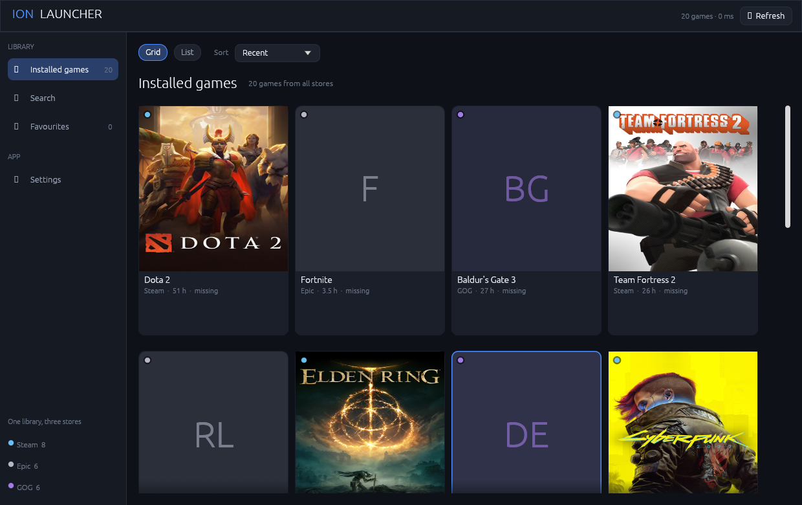
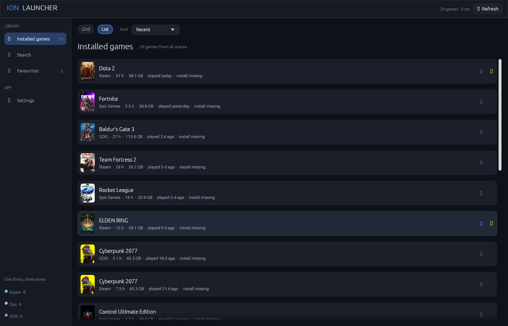
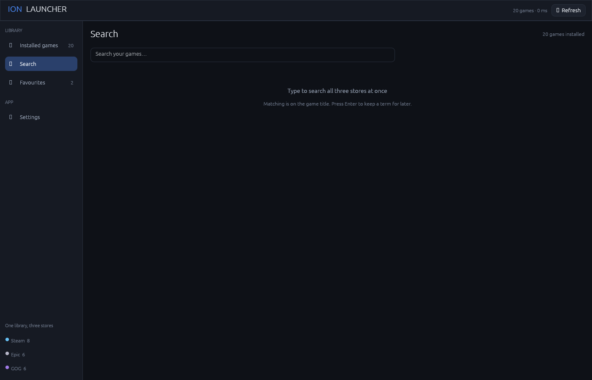
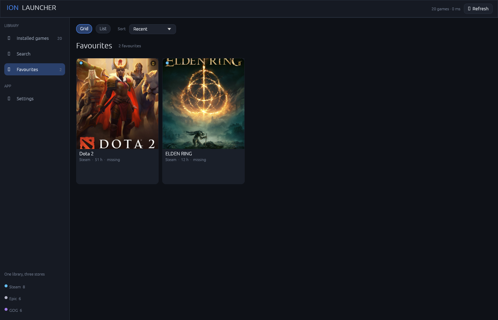
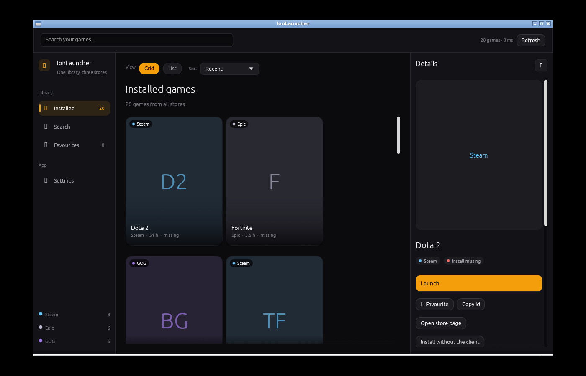
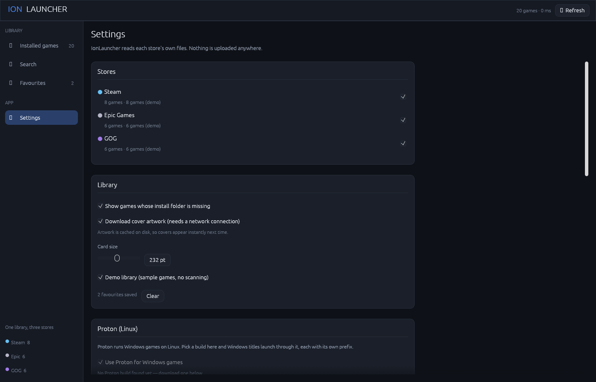

# IonLauncher

A single, fast launcher for your Steam, Epic Games and GOG libraries.

IonLauncher reads the stores' own files directly and shows everything in one
place. It is written in Rust and draws its interface with OpenGL, so it starts
in well under a second, uses a few tens of megabytes of memory, and stays
smooth on older hardware.



## Screenshots

| | |
|---|---|
|  |  |
| Cover grid with the whole library mixed across stores | Compact list with playtime, size and last played |
|  |  |
| Search across all three stores at once | Only the games you starred |
|  |  |
| Details, statistics and launch options | Store detection and Proton settings |

## What it does

- **One library, three stores.** Steam, Epic Games and GOG games appear in a
  single mixed list, each tagged with its store's colour — no separate
  per-store tabs to click through.
- **A left menu of pages.** Installed games, Search, Favourites and Settings,
  with Ctrl+F jumping straight to search.
- **Launch anything.** Games start through their store client by default, so
  cloud saves, achievements and overlays keep working.
- **Search and sort.** A dedicated search page covering all three stores at
  once, and sorting by name, playtime, size or how recently you played.
- **Grid and list views.** A cover grid for browsing, a compact list when you
  want to see a lot at once.
- **Favourites.** Star the games you actually play and find them in one click.
- **Real playtime and size.** Read from each store's metadata, not guessed.

## Supported platforms

| Platform | Steam | Epic Games | GOG |
|---|---|---|---|
| Linux | yes | yes (via Heroic) | yes (via GOG Galaxy or Heroic) |
| Windows | yes | yes | yes (via registry or GOG Galaxy) |
| macOS | yes | yes (via Heroic) | yes (via Heroic) |

## Install

### Windows

Download `IonLauncher-<version>-Setup.exe` from the
[releases page](https://github.com/ciao22king/IonLauncher/releases) and run it.
The wizard walks through the licence, the install folder and where to put the
shortcuts; the desktop shortcut is ticked by default. Uninstall from Settings →
Apps, or with the shortcut in the Start menu folder.

The installer is a normal Windows program: no admin rights beyond writing to
Program Files, and no runtime to install alongside it.

### Linux

Two packages are published, both for x86_64.

**Debian package.** Download `ionlauncher_<version>_amd64.deb` and install it:

```sh
sudo apt install ./ionlauncher_1.0.0_amd64.deb
```

This puts the binary in `/usr/bin`, adds IonLauncher to your applications menu
with the right icon at every size, and pulls in the graphics libraries it needs.
Remove it with `sudo apt remove ionlauncher`.

**AppImage.** Download `ionlauncher-<version>-x86_64.AppImage`, make it
executable and run it:

```sh
chmod +x ionlauncher-1.0.0-x86_64.AppImage
./ionlauncher-1.0.0-x86_64.AppImage
```

The AppImage needs no installation and no root, which suits a machine you do
not administer. If your system has no FUSE, run it with
`APPIMAGE_EXTRACT_AND_RUN=1`.

### macOS

Download `IonLauncher-<version>.dmg`, open it and drag IonLauncher to
Applications. The app is universal, so the same download runs on Apple silicon
and Intel Macs, and it needs macOS 11 or newer.

The build is signed ad-hoc rather than with a Developer ID, so the first launch
after a download needs a right-click → Open, or
`xattr -d com.apple.quarantine /Applications/IonLauncher.app`. macOS remembers
the choice afterwards.

### From source

You need a Rust toolchain (1.82 or newer).

```sh
git clone https://github.com/ciao22king/IonLauncher
cd IonLauncher
cargo build --release
./target/release/ionlauncher
```

The release binary is around 5 MB and has no runtime dependencies beyond your
graphics driver and the store clients you already have.

### Building the Windows installer

The `.exe` and the setup wizard cross-compile from Linux:

```sh
rustup target add x86_64-pc-windows-gnu
sudo apt install mingw-w64 nsis

cargo build --release --target x86_64-pc-windows-gnu
mkdir -p dist && cp target/x86_64-pc-windows-gnu/release/ionlauncher.exe dist/
version=$(sed -n 's/^version *= *"\([^"]*\)".*/\1/p' Cargo.toml | head -1)
cd installer && makensis -V2 -DAPP_VERSION="$version" ionlauncher.nsi
```

The installer takes its version from `Cargo.toml` through `-DAPP_VERSION`, so
the setup file cannot drift from the binary it wraps. Without the flag it
falls back to the placeholder version in the script.

The result is `dist/IonLauncher-<version>-Setup.exe`. The same steps run in
[`.github/workflows/windows-installer.yml`](.github/workflows/windows-installer.yml),
which uploads the installer as a build artifact and attaches it to the release
when you push a `v*` tag.

### Building the Linux packages

Both package scripts take an already-built binary, so build first:

```sh
cargo build --release

./installer/linux/build-deb.sh        # dist/ionlauncher_<version>_amd64.deb
./installer/linux/build-appimage.sh   # dist/ionlauncher-<version>-x86_64.AppImage
```

The `.deb` needs `dpkg-deb` (Debian, Ubuntu and their derivatives). The AppImage
needs `file` and a network connection the first time, to fetch `appimagetool`.
Both scripts run in
[`.github/workflows/linux-packages.yml`](.github/workflows/linux-packages.yml),
which also installs the package and launches the AppImage to prove they work.

### Building the macOS app

This step needs macOS, because `hdiutil`, `codesign` and `lipo` have no Linux
equivalent:

```sh
cargo build --release --target aarch64-apple-darwin
cargo build --release --target x86_64-apple-darwin

UNIVERSAL_SECOND_BINARY=target/x86_64-apple-darwin/release/ionlauncher \
  ./installer/macos/build-macos.sh target/aarch64-apple-darwin/release/ionlauncher
```

The result is `dist/IonLauncher.app` and `dist/IonLauncher-<version>.dmg`. The
second binary is optional; leave it out for a single-architecture build.
[`.github/workflows/macos-package.yml`](.github/workflows/macos-package.yml)
builds both slices and lipos them into one universal app.

## Try it without installing any games

```sh
ionlauncher --demo
```

This loads a built-in sample library so you can see the interface. Demo mode
lasts for that session only; it is never written to your settings.

### Command line

```
ionlauncher [OPTIONS]

  --demo            Show the built-in sample library
  --print-library   Print the detected library and exit (no window)
  --check-updates   Check GitHub for a newer release and exit
  --version         Print the version
  --help            Print this help
```

`--print-library` is handy for checking detection without a display:

```
$ ionlauncher --print-library
IonLauncher library (3 games)
  Steam        3 games

  Team Fortress 2        Steam      1560 h    24.0 GB  steam://runsappid/440
  Portal 2               Steam        60 h    12.0 GB  steam://runsappid/620
```

## Updates

IonLauncher is not in any app store, so it checks for new versions itself. On
startup it asks the GitHub releases API whether a newer release exists, and
shows a banner in Settings → Updates if one does.

- The check is a single request to the public releases page. Nothing about you
  or your library is sent, and there is no telemetry.
- Downloading an update never installs it silently. The installer is saved to
  `IonLauncher-updates` in your downloads folder, and you choose when to run
  it — the same file you would have downloaded from the releases page.
- Only stable releases are offered; drafts and pre-releases are ignored.
- Turn the startup check off in Settings, or skip a single version you do not
  want to be reminded about.

From a terminal, without opening a window:

```sh
ionlauncher --check-updates
```

## How detection works

Nothing is uploaded anywhere. IonLauncher only reads files that are already on
your disk.

- **Steam** — `steamapps/libraryfolders.vdf` for every library folder,
  `appmanifest_*.acf` for the installed games, and
  `userdata/<id>/config/localconfig.vdf` for playtime and last-played times.
- **Epic Games** — the launcher's `Manifests/*.item` files, plus Heroic's
  `legendary` config and installed-game records.
- **GOG** — the Windows registry keys Galaxy writes, the Galaxy SQLite database
  (`galaxy-2.0.db`), and Heroic's `gog_store` records.

Store paths are found automatically. If yours live somewhere unusual, set them
in **Settings → Library paths**.

## Configuration

Settings are saved to `config.json` in your platform's config directory:

- Linux: `~/.config/IonLauncher/config.json`
- Windows: `%APPDATA%\IonLauncher\config.json`
- macOS: `~/Library/Application Support/IonLauncher/config.json`

Artwork is cached separately (under `~/.cache/IonLauncher/art` on Linux) and
trimmed at startup so it cannot grow without bound.

## Performance notes

The interface is built for machines that are not fast:

- Covers are downloaded once, resized on a worker thread, and cached to disk.
  Only the downscaled copy is uploaded to the GPU.
- The filtered, sorted game list is cached and only recomputed when a filter,
  the sort order or the library actually changes, so scrolling does not re-sort
  every frame.
- Scanning runs on a background thread; the window opens immediately and fills
  in as results arrive.
- Shadows, multisampling, depth and stencil buffers are disabled, and the app
  uses a plain OpenGL context rather than a heavier rendering backend.

## Development

On Linux, `eframe` needs the usual desktop development headers to build:

```sh
# Debian / Ubuntu
sudo apt install libgl1-mesa-dev libx11-dev libxcursor-dev libxrandr-dev \
                 libxi-dev libxkbcommon-dev libwayland-dev

# Fedora
sudo dnf install mesa-libGL-devel libX11-devel libXcursor-devel libXrandr-devel \
                 libXi-devel libxkbcommon-devel wayland-devel
```

Then:

```sh
cargo test      # 111 unit tests
cargo build     # debug build
cargo run -- --demo
```

The code is split by concern:

```
src/
  main.rs          entry point and command-line handling
  model.rs         Game, Store, LaunchTarget and the scan report
  vdf.rs           Valve VDF parser (Steam's config format)
  sqlite.rs        read-only SQLite reader (GOG Galaxy's database)
  json_util.rs     case- and separator-tolerant JSON lookups
  util.rs          filesystem, time and process helpers
  config.rs        settings and persistence
  art.rs           artwork download, decode, downscale and disk cache
  theme.rs         colours and egui style
  widgets.rs       reusable widgets (game card, buttons, chips)
  ui.rs            panel frames
  providers/       one module per store, plus the Windows registry reader
  app/             application state and the UI screens
```

## Licence

GPL-2.0-or-later. See [LICENSE](LICENSE).
